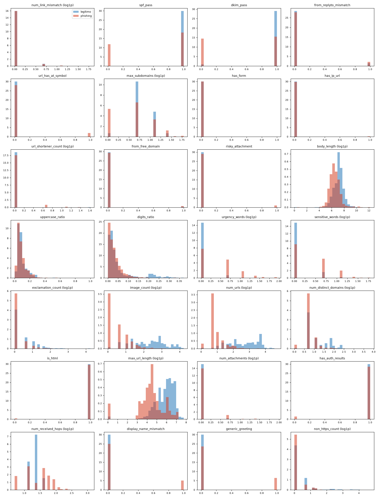

# Auditoría del dataset

Dataset: 4879 correos (2500 phishing, 2379 legítimos). Todo se calcula solo con la partición train, con validación cruzada de 5 pliegues agrupada por dominio remitente (un remitente nunca está a la vez en entrenamiento y evaluación).

## Partición (estratificada y agrupada por dominio remitente)

| Partición | Phishing | Legítimos | Total |
|---|---|---|---|
| train | 2000 | 1905 | 3905 |
| val | 250 | 237 | 487 |
| test | 250 | 237 | 487 |

## 1. Poder de cada característica por sí sola

Árbol de decisión de profundidad 2 entrenado con una sola característica. Una exactitud ≥ 90% indica que esa variable casi decide sola la clase y debe revisarse.

| Característica | Exactitud | AUC | Media phishing | Media legítimo | % ≠0 phishing | % ≠0 legítimo | Alerta |
|---|---|---|---|---|---|---|---|
| num_urls | 87.1% | 0.928 | 2.120 | 20.147 | 95% | 99% |  |
| image_count | 85.1% | 0.913 | 1.300 | 13.954 | 50% | 99% |  |
| max_url_length | 79.0% | 0.806 | 172.408 | 488.199 | 95% | 99% |  |
| dkim_pass | 72.0% | 0.709 | 0.517 | 0.970 | 52% | 97% |  |
| urgency_words | 71.9% | 0.716 | 0.797 | 0.053 | 50% | 5% |  |
| body_length | 70.4% | 0.721 | 1157.918 | 1666.226 | 100% | 100% |  |
| num_received_hops | 70.4% | 0.772 | 3.571 | 2.834 | 100% | 100% |  |
| spf_pass | 69.0% | 0.694 | 0.605 | 0.999 | 60% | 100% |  |
| sensitive_words | 66.9% | 0.671 | 0.647 | 0.128 | 46% | 11% |  |
| max_subdomains | 65.8% | 0.653 | 1.077 | 1.329 | 68% | 96% |  |
| num_distinct_domains | 63.8% | 0.630 | 1.306 | 2.739 | 95% | 99% |  |
| exclamation_count | 62.4% | 0.602 | 0.348 | 1.273 | 19% | 42% |  |
| generic_greeting | 59.7% | 0.599 | 0.215 | 0.002 | 22% | 0% |  |
| non_https_count | 59.0% | 0.544 | 0.293 | 1.809 | 15% | 31% |  |
| display_name_mismatch | 57.3% | 0.580 | 0.167 | 0.001 | 17% | 0% |  |
| uppercase_ratio | 55.2% | 0.558 | 0.091 | 0.094 | 100% | 100% |  |
| digits_ratio | 54.3% | 0.580 | 0.033 | 0.054 | 86% | 98% |  |
| num_attachments | 52.7% | 0.530 | 0.124 | 0.023 | 9% | 2% |  |
| url_has_at_symbol | 52.2% | 0.530 | 0.068 | 0.000 | 7% | 0% |  |
| url_shortener_count | 51.4% | 0.522 | 0.071 | 0.009 | 6% | 0% |  |
| num_link_mismatch | 51.3% | 0.503 | 0.059 | 0.055 | 4% | 5% |  |
| has_ip_url | 51.2% | 0.502 | 0.007 | 0.000 | 1% | 0% |  |
| has_form | 51.2% | 0.500 | 0.001 | 0.000 | 0% | 0% |  |
| from_free_domain | 51.2% | 0.502 | 0.023 | 0.013 | 2% | 1% |  |
| is_html | 51.2% | 0.506 | 0.985 | 0.998 | 98% | 100% |  |
| risky_attachment | 51.2% | 0.514 | 0.032 | 0.001 | 3% | 0% |  |
| has_auth_results | 51.0% | 0.521 | 0.953 | 1.000 | 95% | 100% |  |
| from_replyto_mismatch | 49.9% | 0.503 | 0.073 | 0.048 | 7% | 5% |  |

## 2. Dependencia de las cabeceras de infraestructura

Random Forest de referencia (no es el modelo final). Si quitar SPF, DKIM, Authentication-Results y los saltos casi no cambia el resultado, el modelo no depende de cómo se recibió cada corpus.

| Conjunto de características | Exactitud | F1 | AUC |
|---|---|---|---|
| 28 características | 94.5% | 0.948 | 0.991 |
| sin infraestructura (SPF, DKIM, Auth-Results, saltos) | 91.8% | 0.923 | 0.981 |
| solo infraestructura | 87.0% | 0.860 | 0.912 |

## 3. Generalización entre fuentes de phishing

Se entrena con el phishing de una fuente y se evalúa con el de la otra; los legítimos se dividen por remitente. Un recall alto indica que el modelo aprende rasgos de phishing y no rasgos de la fuente.

| Entrenamiento → evaluación | Características | Exactitud | Recall phishing | AUC |
|---|---|---|---|---|
| nazario → phishing_pot | 28 características | 91.9% | 95.5% | 0.971 |
| nazario → phishing_pot | sin num_received_hops | 90.5% | 95.4% | 0.972 |
| nazario → phishing_pot | sin infraestructura | 89.2% | 92.5% | 0.964 |
| phishing_pot → nazario | 28 características | 83.5% | 71.7% | 0.950 |
| phishing_pot → nazario | sin num_received_hops | 89.7% | 95.0% | 0.976 |
| phishing_pot → nazario | sin infraestructura | 90.9% | 94.4% | 0.972 |

Distinguir Nazario de phishing_pot con las 28 características: exactitud 94.6%, AUC 0.983. Es esperable que sea alto (son épocas y víctimas distintas); lo importante es que el punto 3 muestre que el phishing de una fuente se detecta con lo aprendido de la otra.

Saltos `Received` por fuente (media / mediana): nazario 2.3 / 2, personal 2.8 / 3, phishing_pot 4.9 / 5. El número de saltos depende sobre todo del servidor que recibió cada corpus (Outlook para phishing_pot, monkey.org para Nazario, Gmail para los legítimos), no del remitente.

## 4. Cobertura de correos legítimos cortos

Correos con 3 enlaces o menos: 10.8% de los legítimos y 86.6% del phishing. Si los legítimos son casi todos boletines con muchos enlaces e imágenes, el modelo asociará "pocos enlaces" con phishing y fallará con correos personales o institucionales cortos.

## Histogramas por clase (train)

