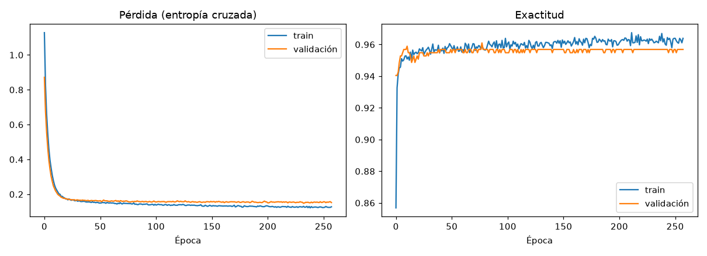
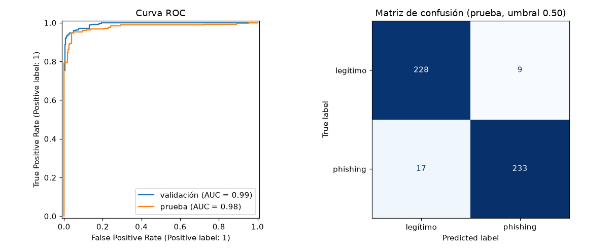

# Entrenamiento del MLP

Arquitectura: 22 -> 64 -> 32 -> 1 (ReLU, Dropout 0.3, L2 0.01, sigmoide). Adam (lr 0.001), entropía cruzada binaria, lotes de 128. EarlyStopping sobre la pérdida de validación (paciencia 25): 258 épocas ejecutadas, mejor época 233.

Umbral de decisión: **0.50** (fijo). En validación, el umbral con máximo F1 sería 0.36 (F1 0.960, frente a 0.957 con 0.50): la curva de F1 es plana y ese máximo cambia mucho entre particiones, así que no se ajusta.

| Modelo / conjunto | Exactitud | Precisión | Recall | F1 | AUC | Falsos positivos | Falsos negativos |
|---|---|---|---|---|---|---|---|
| MLP · train | 96.8% | 97.6% | 96.2% | 0.969 | 0.995 | 48 | 76 |
| MLP · validación | 95.7% | 97.9% | 93.6% | 0.957 | 0.993 | 5 | 16 |
| **MLP · prueba (umbral 0.50)** | 94.7% | 96.3% | 93.2% | 0.947 | 0.979 | 9 | 17 |

Metas del documento: exactitud, precisión, recall y F1 > 90 %; AUC ≥ 0,9.

Los hiperparámetros se eligen solo con validación. El conjunto de prueba nunca se usa para tomar decisiones; cada ejecución lo evalúa una vez y queda registrada en `experiments.csv`.

## Errores en prueba

| Archivo | Clase real | Fuente | Score |
|---|---|---|---|
| phishing/a0444c1772c2a1309565.eml | phishing | phishing_pot | 0.003 |
| phishing/560b09929b33b13901b6.eml | phishing | phishing_pot | 0.004 |
| phishing/b3e4d230134008d8494b.eml | phishing | phishing_pot | 0.007 |
| phishing/8219ecd9ebf4b3ecf653.eml | phishing | phishing_pot | 0.035 |
| phishing/7cd87bb878a309cf28c8.eml | phishing | phishing_pot | 0.115 |
| phishing/e1420fab4bc2134b3575.eml | phishing | nazario | 0.126 |
| phishing/210aecab8b6bc2003b65.eml | phishing | phishing_pot | 0.127 |
| phishing/b074e0c63ec361979aa2.eml | phishing | phishing_pot | 0.166 |
| phishing/7ad0bbb9fc6c2a08230a.eml | phishing | nazario | 0.221 |
| phishing/bb3766249f2eef9be0a2.eml | phishing | phishing_pot | 0.233 |
| phishing/7db4ec64a9cadc00073a.eml | phishing | phishing_pot | 0.235 |
| phishing/399b8157b79cae21965b.eml | phishing | phishing_pot | 0.235 |
| phishing/3533f8bfa6bfe430a047.eml | phishing | nazario | 0.337 |
| phishing/36d8433a64e1b330486d.eml | phishing | phishing_pot | 0.379 |
| phishing/4615e0a19032fc4e2a1e.eml | phishing | nazario | 0.468 |
| phishing/0bb90b214cad6e3aa59f.eml | phishing | phishing_pot | 0.470 |
| phishing/26aae68698c118b4b97d.eml | phishing | nazario | 0.499 |
| legitimate/018c13ec33db26b35705.eml | legítimo | personal | 0.687 |
| legitimate/99fbd46f8a438a90b72e.eml | legítimo | personal | 0.687 |
| legitimate/a2a9f4b58b6160b174b5.eml | legítimo | personal | 0.709 |
| legitimate/142e6594ad36e7715f8f.eml | legítimo | personal | 0.789 |
| legitimate/55dfe5ada1335c691e64.eml | legítimo | personal | 0.818 |
| legitimate/ba1badfc585ea14279cc.eml | legítimo | personal | 0.888 |
| legitimate/c5812244ceaf22535335.eml | legítimo | personal | 0.888 |
| legitimate/007fd578c7372b2c6449.eml | legítimo | personal | 0.897 |
| legitimate/2f0f2f47b4f8a097dd8c.eml | legítimo | personal | 0.897 |
